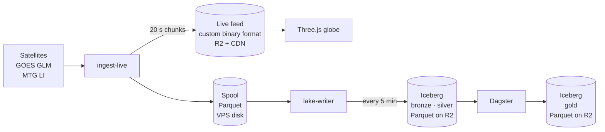

# Scintille

**[scintille.app](https://scintille.app)**

Lightning across the whole planet, live, on a cinematic 3D globe. Every flash seen by the NOAA GOES
and EUMETSAT MTG weather satellites lands on the globe within minutes, as bright as the satellites
measured it.

## Under the hood

Behind the globe runs a small but real lakehouse, fed around the clock by geostationary satellites.



- **Two paths.** `ingest-live` publishes the live feed in 20-second chunks and writes every batch to
  a durable spool; `lake-writer` commits the spool to Iceberg every five minutes, so a catalog
  outage never slows the live globe.
- **Apache Iceberg on Cloudflare R2**, through a REST catalog (R2 Data Catalog in production,
  Lakekeeper locally). Tables are declared in code and `migrate` only applies safe schema changes.
- **Dagster** builds the daily gold tables from SQL files run by DuckDB, checks silver every hour
  and every day (freshness, completeness, ranges, volume, duplicates, and a file-by-file
  reconciliation from spool to silver), tracks storm cells with Polars and backfills GLM days from
  the NOAA archives.
- **A versioned data contract** in Python, with TypeScript types generated from it; CI fails on any
  drift or unversioned schema change. The live feed uses a
  [custom binary format](docs/data-contract.md#chunk-encoding), read in the browser as typed arrays
  and served from the edge.
- **Operations**: Terraform for Cloudflare, Docker Compose on one VPS, deploys that roll back on
  failure, a public status page fed by live metrics.

Every significant choice is an [ADR](docs/adr/); the full picture is in
[architecture](docs/architecture.md).

## Running locally

```sh
pnpm -C web install && pnpm -C web dev    # site and globe
cd data && uv sync && uv run pytest       # data stack
```

`make` lists every check and deploy.

## Data & attribution

The code is released under the [MIT License](LICENSE). The data it reads and publishes is not: each
source keeps its own terms, and anyone redistributing it must keep the credits below.

| Data | Source | Terms |
|---|---|---|
| Lightning, Americas | [NOAA GOES GLM](https://registry.opendata.aws/noaa-goes/) L2 LCFA | NOAA open data. Credit: "GLM data courtesy of NOAA" |
| Lightning, Europe and Africa | [EUMETSAT MTG Lightning Imager](https://www.eumetsat.int/meteosat-third-generation) L2 LFL | [CC BY 4.0](https://creativecommons.org/licenses/by/4.0/) under the EUMETSAT Data Policy. Credit: "Contains modified EUMETSAT Meteosat data 2026" |
| Clouds | [NOAA NESDIS GMGSI](https://registry.opendata.aws/noaa-gmgsi/) | NOAA open data. Credit: "Clouds: NOAA NESDIS GMGSI (contains EUMETSAT Meteosat and JMA Himawari data)" |
| Earth imagery | NASA Blue Marble and Black Marble | Public domain. Credit: NASA Earth Observatory |
| Coastlines, countries, marine areas | [Natural Earth](https://www.naturalearthdata.com/) | Public domain |
| Place names | [GeoNames](https://www.geonames.org/) | [CC BY 4.0](https://creativecommons.org/licenses/by/4.0/). Credit GeoNames wherever names are shown |

Details per file: [assets](docs/assets.md#sources-and-licenses), [reference data](docs/pipelines.md#reference-data)
and [data contract](docs/data-contract.md).
