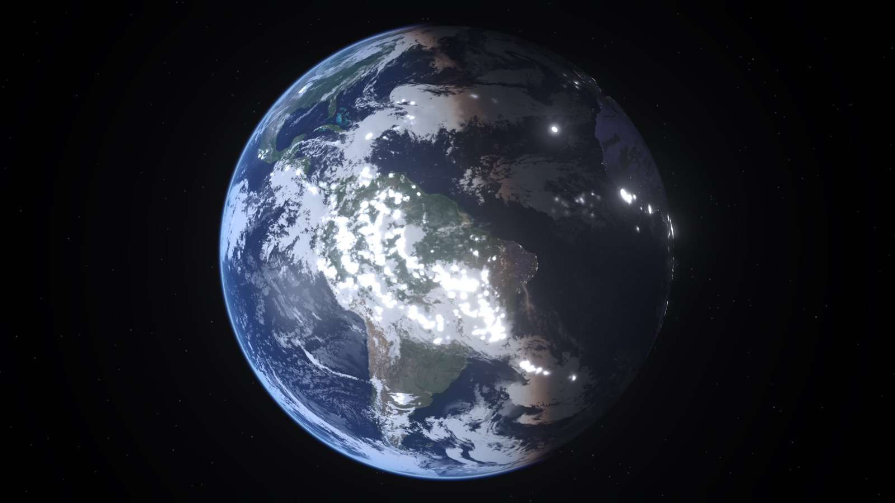
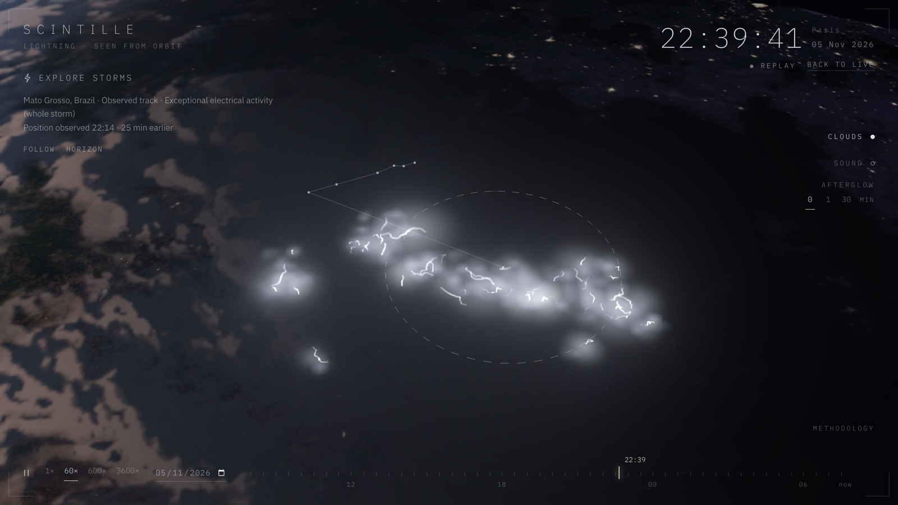
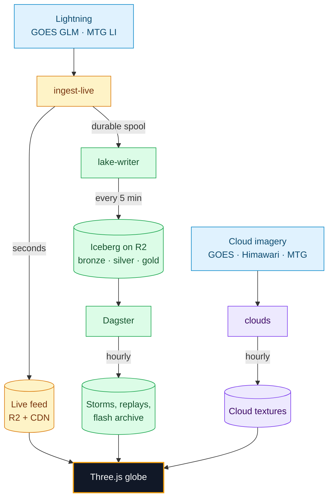

# Scintille

**[scintille.app](https://scintille.app)**

Lightning across the whole planet, live, on a 3D globe. Every flash seen by the NOAA GOES and
EUMETSAT MTG weather satellites lands on the globe within minutes, as bright as the satellites
measured it.



- **Live**: lightning over the Americas, Europe, Africa and the Atlantic.
- **Clouds**: hourly cloud cover from the GOES, Himawari and MTG satellites, in relief from their
  cloud-top heights.
- **Storms**: flashes are grouped into storms, tracked, ranked and named. A storm can be followed
  while it is active, and the strongest ones replayed for 60 days.
- **Travel in time**: the last three weeks of lightning, hour by hour.



## How it works

Behind the globe runs a small lakehouse, fed around the clock by geostationary satellites.



- **Two paths.** `ingest-live` publishes the live feed in chunks of about 20 seconds and writes
  every batch to a durable spool; `lake-writer` commits the spool to Iceberg every five minutes, so
  a catalog outage never slows the live globe.
- **Apache Iceberg on Cloudflare R2**, through a REST catalog (R2 Data Catalog in production,
  Lakekeeper locally). Tables are declared in code and `migrate` only applies safe schema changes.
  Writes are idempotent: a flash id hashes its source file.
- **Dagster** runs the gold models (SQL files run by DuckDB), storm detection and tracking with
  Polars, the hourly storm catalog, the flash archive and backfills from the NOAA archives. Asset
  checks watch silver: freshness, completeness, ranges, volume, duplicates, and a file by file
  reconciliation from spool to silver.
- **A versioned data contract.** JSON Schema files generate the Python models and the TypeScript
  types; CI fails on any drift or unversioned schema change. The live feed uses a
  [compact binary format](docs/data-contract.md#chunk-encoding), read in the browser as typed
  arrays.
- **Operations**: Terraform for Cloudflare, Docker Compose on one VPS, deploys that roll back on
  failure, and a public [status page](https://scintille.app/status/) fed by live metrics.

Every significant choice is an [ADR](docs/adr/). The full picture is in
[architecture](docs/architecture.md) and on the [methodology page](https://scintille.app/methodology/).

## Stack

| Area | Tools |
|---|---|
| Globe and site | TypeScript, Three.js with custom shaders, Astro, Cloudflare Workers |
| Data | Python, Polars, Arrow, DuckDB, Apache Iceberg, Dagster, Postgres |
| Storage | Cloudflare R2, R2 Data Catalog, D1 |
| Infrastructure | Terraform, Docker Compose, GitHub Actions |
| Quality | pytest, Vitest, mypy, ruff, ESLint, Pandera |

## Repository

| Path | Contents |
|---|---|
| [`web/`](web/) | The site and the Three.js globe |
| [`data/`](data/) | Python packages: data contract, ingestion, Iceberg tables, Dagster pipelines |
| [`infra/`](infra/) | Terraform, Docker Compose and the VPS setup |
| [`docs/`](docs/) | Architecture, runbooks and decision records |
| [`fixtures/`](fixtures/) | A recorded hour of data for local runs and tests |

## Running locally

```sh
python3 fixtures/serve.py                 # a recorded hour of lightning and clouds
pnpm -C web install && pnpm -C web dev    # site and globe, on http://localhost:4321
cd data && uv sync && uv run pytest       # data stack
```

The Earth textures are built once ([assets](docs/assets.md)). `make` lists every check and deploy.

## Data and credits

The code is released under the [MIT License](LICENSE). The data it reads and publishes is not: each
source keeps its own terms, and anyone redistributing it must keep the credits below.

| Data | Source | Terms |
|---|---|---|
| Lightning, Americas | [NOAA GOES GLM](https://registry.opendata.aws/noaa-goes/) L2 LCFA | NOAA open data. Credit: "GLM data courtesy of NOAA" |
| Lightning, Europe and Africa | [EUMETSAT MTG Lightning Imager](https://www.eumetsat.int/meteosat-third-generation) L2 LFL | [CC BY 4.0](https://creativecommons.org/licenses/by/4.0/) under the EUMETSAT Data Policy. Credit: "Contains modified EUMETSAT Meteosat data 2026" |
| Clouds | NOAA GOES ABI, JMA Himawari AHI ([NOAA open data on AWS](https://registry.opendata.aws/noaa-himawari/)), EUMETSAT MTG FCI, gaps from [NOAA NESDIS GMGSI](https://registry.opendata.aws/noaa-gmgsi/) | NOAA open data; FCI under CC BY 4.0 as above. Credit: "Clouds: NOAA GOES-East and GOES-West, JMA Himawari-9 via NOAA, contains modified EUMETSAT Meteosat data 2026; gaps from NOAA NESDIS GMGSI" |
| Cloud-top heights | NOAA GFS temperature profiles | NOAA open data |
| Earth imagery | NASA Blue Marble and Black Marble | Public domain. Credit: NASA Earth Observatory |
| Coastlines, countries, marine areas | [Natural Earth](https://www.naturalearthdata.com/) | Public domain |
| Place names | [GeoNames](https://www.geonames.org/) | [CC BY 4.0](https://creativecommons.org/licenses/by/4.0/). Credit GeoNames wherever names are shown |
| Sound | [Freesound](https://freesound.org/) recordings | CC0 |

Details per file: [assets](docs/assets.md#sources-and-licenses), [reference data](docs/pipelines.md#reference-data)
and [data contract](docs/data-contract.md).
