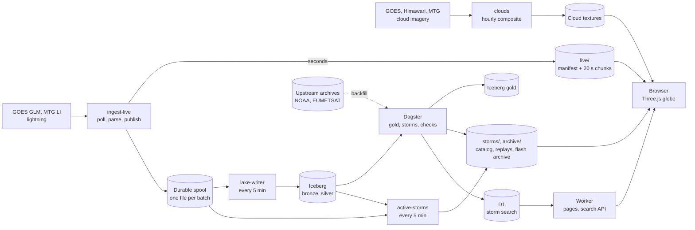

# Architecture

How data flows from the satellites to the browser. Decisions and reasons are in
[ADR 0006](adr/0006-data-architecture.md) (data) and [ADR 0005](adr/0005-hosting-and-dynamic-pages.md)
(hosting); the live feed format is in [the data contract](data-contract.md).

The services run in Docker Compose on one OVH VPS, with Postgres for file state, locks and Dagster.
Everything they publish is stored on Cloudflare R2, the search index in D1.

| Element | Meaning |
|---|---|
| `ingest-live` | Always on, seconds of latency; never waits on the lakehouse |
| Durable spool + `lake-writer` | Decouple the live feed from catalog commits; a catalog outage only grows the spool |
| Dagster | Minutes to hours: gold, the storm catalog and its replays, the flash archive, the search index, checks, backfills and partition rebuilds |
| `active-storms` | Storms active now, rewritten every 5 minutes from silver and the spool |
| `clouds` | Hourly cloud composite and cloud-top heights, published as textures |
| Worker | Serves the prerendered pages and the storm search API |
| Dotted arrow | On demand: backfills from the upstream archives |
| Cylinder | Stored data; Iceberg tables sit behind R2 Data Catalog |
