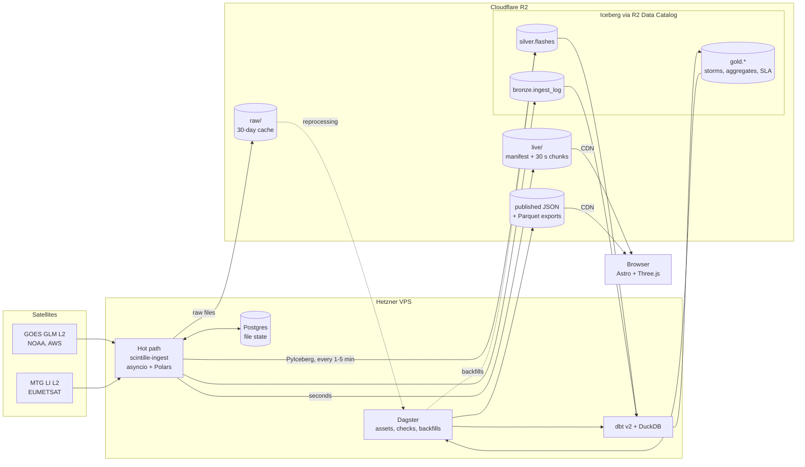

# Architecture

How data flows from the satellites to the browser. Decisions and reasons are in
[ADR 0006](adr/0006-data-architecture.md); the live feed format is in
[the data contract](data-contract.md).

| Element | Meaning |
|---|---|
| Hot path | Always-on service: seconds of latency, publishes the live feed and appends micro-batches to the lakehouse |
| Cold path | Dagster and dbt: minutes to hours, builds gold, runs checks, backfills and exports |
| Solid arrow | Regular data flow |
| Dotted arrow | On demand: backfills and reprocessing |
| Cylinder | Stored data; everything under R2 is object storage, `lake` tables are Apache Iceberg |
