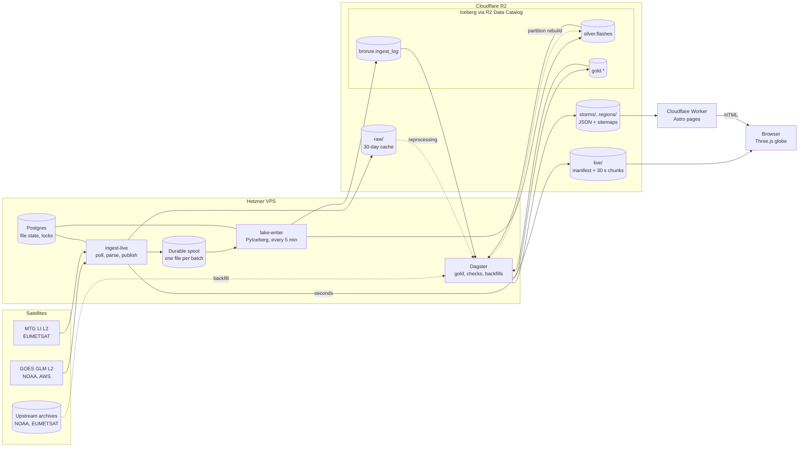

# Architecture

How data flows from the satellites to the browser. Decisions and reasons are in
[ADR 0006](adr/0006-data-architecture.md) (data) and [ADR 0005](adr/0005-hosting-and-dynamic-pages.md)
(hosting); the live feed format is in [the data contract](data-contract.md).

| Element | Meaning |
|---|---|
| `ingest-live` | Always on, seconds of latency; never waits on the lakehouse |
| Durable spool + `lake-writer` | Decouple the live feed from catalog commits; a catalog outage only grows the spool |
| Dagster | Minutes to hours: gold, checks, backfills, published JSON and sitemaps |
| Worker | Serves prerendered pages and renders storm and region pages from published JSON |
| Solid arrow | Regular data flow |
| Dotted arrow | On demand: backfills, reprocessing, partition rebuilds |
| Plain line | Shared state (Postgres), not data flow |
| Cylinder | Stored data; tables under `lake` are Apache Iceberg |
