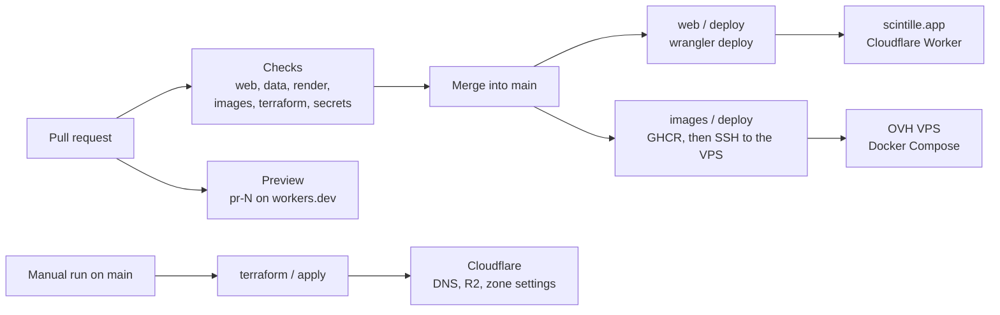

# CI/CD

How code goes from a pull request to production. Everything runs on GitHub Actions; there is no
other CI. This page is the map: what runs when, what each check protects, how the two production
targets (the site on Cloudflare, the data services on the VPS) are deployed, and the switches that
turn deploys on. Details live in [deploy](deploy.md), [secrets](secrets.md) and
[infra/terraform](../infra/terraform/README.md).

## The short version

- Every change goes through a PR into `main` ([AGENTS.md](../AGENTS.md)). Workflows are
  path-filtered, so a PR only pays for the areas it touches.
- A PR that touches `web/` also gets its own Preview of the site, with a URL posted on the PR.
- A merge into `main` deploys what it touched: `web/` goes to `scintille.app`, `data/` and
  `infra/compose/` go to the VPS. Each deploy has a switch, and both are off until the
  infrastructure behind them exists.
- Terraform is never applied automatically: PRs get a plan, `apply` is a manual run.

## Workflows

All workflows live in `.github/workflows/`. Typical durations are from recent runs.

| Workflow | Runs on | Jobs | Typical time |
|---|---|---|---|
| `web` | PR and push to `main` touching `web/**`; PR close; manual | `web`, `preview`, `preview-cleanup`, `deploy` | 40 s checks, 1 min deploy |
| `data` | PR and push to `main` touching `data/**`, `fixtures/**`, `web/src/contract/**`, `docs/data-contract.md`, `compose.yaml`, `infra/local/**` | `data`, `lake` | 2 min |
| `images` | PR and push to `main` touching `data/**`, `compose.yaml`, `infra/local/**`, `infra/compose/**`; manual | `build` (matrix), `smoke`, `rollback`, `deploy` | 4 to 6 min |
| `render` | PR touching `web/src/**`, the render script, the web lockfile or `fixtures/live/**`; manual | `determinism` | 4 min |
| `terraform` | PR touching `infra/terraform/**`; manual | `plan`, `apply` | 15 s |
| `secrets` | Every PR and every push to `main` | `gitleaks` | 15 s |

Each workflow also triggers on changes to its own file, so editing a workflow runs it.

### `web`: the site

`web` job, on every PR and push: `pnpm install --frozen-lockfile`, then the same commands a
contributor runs locally (`check`, `lint`, `test`, `build`), plus `test:seo` (unique title, description and
canonical URL per page, valid JSON-LD, robots.txt, llms.txt and sitemap built) and `wrangler deploy --dry-run`, which validates the generated Wrangler
config without uploading anything.

The three other jobs need Cloudflare and only run when the repository variable `DEPLOY_ENABLED` is
`true`:

- **`preview`** (PRs from this repository only, never forks): builds the PR, appends
  `X-Robots-Tag: noindex` to `_headers`, uploads it with `wrangler preview --name pr-<n>`, checks the
  header is served and posts or updates one comment on the PR with the URL. Previews are bound to
  the `scintille-live-preview` bucket, never production data.
- **`preview-cleanup`**: on PR close or merge, deletes the `pr-<n>` Preview.
- **`deploy`** (push to `main` or a manual run on `main`): rebuilds with the production-only
  variables (Web Analytics token), runs `wrangler deploy --message <sha>`, then polls
  `https://scintille.app/version.json` until it reports the commit just deployed (up to 5 minutes).
  That last check only runs when `SITE_PUBLIC` is `true`, since the pre-launch Access gate hides
  the site from CI.
  Deploys are serialized by the `web-deploy-production` concurrency group and never cancelled.

To redeploy `main` without a change: Actions > web > Run workflow, or
`gh workflow run web.yml --ref main`.

### `data`: Python packages and the lakehouse

`data` job, from `data/`: `uv sync --frozen`, `ruff check`, `ruff format --check`, `mypy` (strict),
the contract check, then `pytest` (unit tests; `network` and `lake` tests are excluded by default).

The contract check (`scintille-contract check --base <ref>`) regenerates the TypeScript contract in
`web/src/contract/` and fails if it differs from what is committed, or if the schema changed without
a `SchemaVersion` bump ([data contract](data-contract.md)). It compares against the PR base, or
against the previous `main` commit on a push, which is why this job checks out the full history.

`lake` job: starts the local lakehouse from the root `compose.yaml` (Lakekeeper, Postgres, an S3
store), runs the table migrations twice (the second run must report "up to date") and then
`pytest -m lake` against it. Container logs are printed on failure.

### `images`: containers and the VPS

- **`build`**: one Docker image per service from `data/Dockerfile` (`scintille-ingest`,
  `scintille-pipelines`), with the GitHub Actions layer cache. On `main` it pushes
  `ghcr.io/pierregc/scintille-<package>:<sha>` and `:main`. On PRs it only builds.
- **`smoke`**: starts the VPS stack locally (`infra/compose/compose.local.yaml`, which layers the
  production compose file on the local lakehouse) and checks, in order: the Dagster webserver answers,
  the daemon passes its liveness check, containers run as the non-root user `10001`, `ingest`
  exposes metrics, raw GLM files reach the raw cache, the live manifest lists chunks with flashes,
  and the cloud manifest lists frames. This job reads the real NOAA buckets, so an upstream outage
  can turn it red.
- **`rollback`**: runs `infra/compose/test_deploy.sh`, which deploys a healthy release, then a broken
  one, and asserts that `deploy.sh` rolled back to the first one with its own compose file.
- **`deploy`**: see [VPS deploy](#vps-deploy) below.

### `render`: deterministic frames

Builds the site against the fixture hour, serves it with the fixtures, renders 30 frames twice with
headless Chromium (SwiftShader) and requires byte-identical PNGs. It also measures a 1080p render and
uploads the frames as an artifact for 7 days ([render](render.md)). It fetches the Earth textures
from `data.scintille.app`, so it needs that host to be up. It runs on PRs only, not on `main`.

### `terraform`: Cloudflare infrastructure

- **`plan`** (PRs): `terraform fmt -check`, `init -backend=false`, `validate`, then a real `plan`
  against the R2 state if all secrets and variables are present, written to the job summary.
  Without credentials the plan is skipped with a notice, not failed.
- **`apply`** (manual run on `main` only, in the `terraform` environment, which can require an
  approval): `plan -out`, then `apply` of that exact plan. Run it with
  `gh workflow run terraform --ref main`.

### `secrets`: leak scanning

`gitleaks` scans the commits of every PR and every push to `main`. A finding fails the check; never
"fix" it by rewriting the check, rotate the secret ([secrets](secrets.md#rotation)).

## Deployments

### Site deploy

The site is one Cloudflare Worker, `scintille`, serving prerendered assets on `scintille.app`
([ADR 0005](adr/0005-hosting-and-dynamic-pages.md)). A deploy is atomic: the new version answers as
soon as `wrangler deploy` returns. Every build is stamped with its commit (`/version.json` and the
footer of the About sheet), which is how the `deploy` job and a human can tell what is live.

Rollback: Workers & Pages > `scintille` > Deployments > Rollback, or `wrangler rollback`; the durable
fix is a revert PR ([deploy](deploy.md#rollback)).

Until launch, `scintille.app` is behind a Cloudflare Access gate (#142); Previews and
`data.scintille.app` are public.

### VPS deploy

Ingestion and Dagster run on one OVH VPS with Docker Compose ([ADR 0008](adr/0008-ovh-vps.md)). On a
push to `main`, once `build`, `smoke` and `rollback` are green, the `deploy` job (environment
`production`, serialized by the `vps-deploy` group):

1. writes the SSH key and the pinned host key from secrets;
2. copies `infra/compose/compose.yaml` to `/srv/scintille/releases/<sha>/` and `deploy.sh` to
   `/srv/scintille/`;
3. runs `deploy.sh <sha>` on the VPS as `deploy`.

`deploy.sh` pulls the `<sha>` images, runs `docker compose up --wait` and, if a healthcheck fails
within 180 s, starts the previous release again with its own compose file and exits non-zero, which
fails the job. It keeps the last five releases. Settings and secrets of the services live in
`/srv/scintille/.env` on the VPS, never in the repository; changing them is a manual step.

## Switches, secrets and variables

| Name | Kind | Used by | Effect |
|---|---|---|---|
| `DEPLOY_ENABLED` | Variable | `web` | `true` turns on `deploy`, `preview` and `preview-cleanup` |
| `SITE_PUBLIC` | Variable | `web` | `true` turns on the post-deploy version check (after #142) |
| `VPS_DEPLOY` | Variable | `images` | `true` turns on the VPS `deploy` job |
| `VPS_HOST` | Variable | `images` | VPS address |
| `CF_WEB_ANALYTICS_TOKEN` | Variable | `web` | Public Web Analytics token, production builds only |
| `CLOUDFLARE_ZONE_ID`, `WORKERS_SUBDOMAIN` | Variables | `terraform` | Terraform inputs |
| `CLOUDFLARE_API_TOKEN` | Secret | `web` | Wrangler deploys and Previews (Workers Scripts Edit, R2 Read) |
| `CLOUDFLARE_ACCOUNT_ID` | Secret | `web`, `terraform` | Account for Wrangler and Terraform |
| `TF_CLOUDFLARE_API_TOKEN` | Secret | `terraform` | Terraform's own Cloudflare token |
| `TF_STATE_ACCESS_KEY_ID`, `TF_STATE_SECRET_ACCESS_KEY` | Secrets | `terraform` | R2 state bucket |
| `VPS_SSH_KEY`, `VPS_KNOWN_HOSTS` | Secrets | `images` | SSH as `deploy`, with a pinned host key |
| `GITHUB_TOKEN` | Built in | `images`, `web`, `secrets` | GHCR push, the Preview comment, gitleaks |

The two deploy switches have different names for historical reasons: `DEPLOY_ENABLED` came with the
site, `VPS_DEPLOY` with the data services. Scopes and rotation of every secret are in
[secrets](secrets.md).

## Conventions in the workflows

Follow these when adding or editing a workflow:

- **Pin third-party actions to a commit SHA**, with the version as a comment
  (`uses: actions/checkout@<sha> # v7.0.1`). Base images in `data/Dockerfile` are pinned by digest.
- **Least privilege.** Every workflow starts with `permissions: contents: read`; a job that needs
  more asks for it (`packages: write` to push images, `pull-requests: write` for the Preview comment).
- **Secrets only where needed**, passed as `env` to the step that uses them, never interpolated into
  a `run:` script. Jobs that use secrets on PRs skip forks
  (`head.repo.full_name == github.repository`).
- **Concurrency.** One group per workflow and ref. PR runs cancel superseded ones; deploys never
  cancel and use their own group (`web-deploy-production`, `vps-deploy`, `terraform-apply`).
- **Timeouts.** Every job has `timeout-minutes`.
- **Path filters** list everything the workflow reads, including its own file. A new input (a fixture
  folder, a config file) must be added to the filter or the check silently stops covering it.
- **Same commands as locally.** CI calls the `pnpm` and `uv run` commands from
  [AGENTS.md](../AGENTS.md); if a check is worth running in CI, it is worth a local command.
- **Budget.** The repository is private until launch, with 2,000 free Actions minutes a month. Keep
  jobs lean and cached (pnpm store, uv cache, Docker layers).

## When a check is red

| Check | Usual cause | What to do |
|---|---|---|
| `data / Contract is generated and versioned` | Schema changed without regenerating or bumping | `uv run scintille-contract generate`, bump `SchemaVersion` ([data contract](data-contract.md)) |
| `web / test:seo` | A page lost or duplicated its title, description or canonical, or broke its JSON-LD | Fix the page, see `web/scripts/check-seo.mjs` |
| `web / wrangler deploy --dry-run` | Invalid `wrangler.jsonc` or binding | Build locally and run the same command |
| `render / Compare frames` | Something non-deterministic in the render path | Look for time, random or async ordering in `web/src/globe` ([render](render.md)) |
| `images / smoke`, wait step | A service is unhealthy; logs are at the end of the job | Find the unhealthy container in the logs |
| `images / smoke`, manifest steps | No flashes or frames within 2 to 3 minutes; can be an upstream outage | Check the ingest logs, then NOAA availability |
| `secrets / gitleaks` | Something looks like a secret | If real: remove it and rotate. If a false positive: allowlist it in a gitleaks config, in its own PR |
| `web / deploy`, version check | The new version is not served on `scintille.app` | See the step log, then Workers & Pages > Deployments |

A failure that also happens on `main` is not your PR's: say so on the PR rather than working around
it.

## Known issues

Found during the CI/CD review of October 2026, each tracked in its own ticket:

- #187: Dagster webserver and daemon race to create their storage on a fresh Postgres (flaky
  `smoke`).
- #188: merged commits on `main` can skip the `data` and `secrets` checks, and the VPS deploy does
  not wait for the data tests.
- #189: path filters miss files that web tests and the render check depend on.
- #190: `smoke` rebuilds the images instead of testing the ones that get deployed.
- #191: floating Node and uv versions, no automated updates of pinned actions and images.
- #192: duplicated web setup steps, Preview stamped with a commit it did not build.
- #193: no linting of workflows and shell scripts; deploy secrets wider than needed.
- #194: the VPS health gate does not cover `lake-writer` and `live-probe`.

Remove a line here when its ticket is closed.
