# Cloud look: analysis and validation

Companion to [ADR 0031](adr/0031-cloud-look.md): why the relief clouds of ADR 0028 looked broken,
what replaced them, how the result was checked against observations, and what remains. The rules
themselves live in the ADR and in [immersive view](immersive-view.md#clouds-in-relief).

## Diagnosis

Four independent defects, plus one data gap, measured on the reported capture (storm follow,
Kampene, 2026-10-27 08:50 UTC) and on live frames of 2026-10-29.

| Symptom | Cause | Fix |
|---|---|---|
| Repeating grid | One 64³ Perlin-Worley tile, period 22 km, axis-aligned in Earth-frame km. The capture's autocorrelation peaks on a 49 × 22 km lattice | Hashed gradient noise without period, only where the observed neighbourhood calls for it |
| Cotton grain | Noise cells of 0.25 to 5.5 km under 1 km pixels, no filtering by footprint | Octaves finer than 2.5 window texels dropped |
| Hatching, even without noise | March started at a jittered offset with steps up to 16 km near the vertical, so tops were skipped at random | Closed-form integration of each column crossing, low-discrepancy jitter averaged by the history |
| Grey anvils | Sunlight baked at 0, 4, 8 and 12 km only; 13 to 16 km tops read the 12 km value | Sun baked at the ground and at each column's own top |
| Relief on Kampene | Detail tiles and heights had expired (kept 24 h): the noise invented every shape | No height, no volume: the flat layer shows, pixel by pixel |

## Before and after

Same live scene, same moment, old renderer on the left, new on the right (2026-10-29 around
22:40 UTC, Chromium on the reference Mac).

Kampene, the reported view. The frame has no heights any more, so the flat layer shows, sharp and
without invented relief:
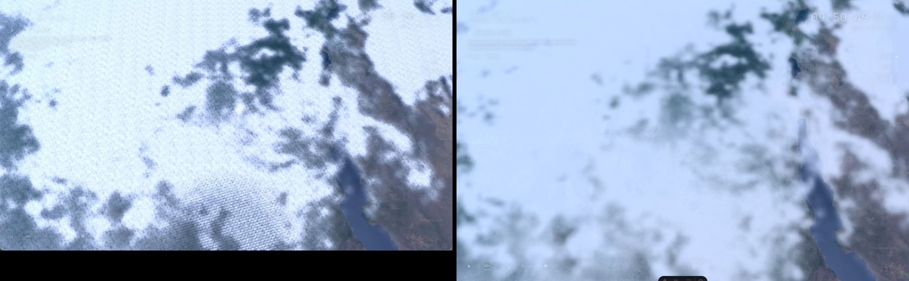

Pacific at noon, `window` pose: frosted cotton and grey lakes, then white clouds in relief with the
blue haze toward the horizon:
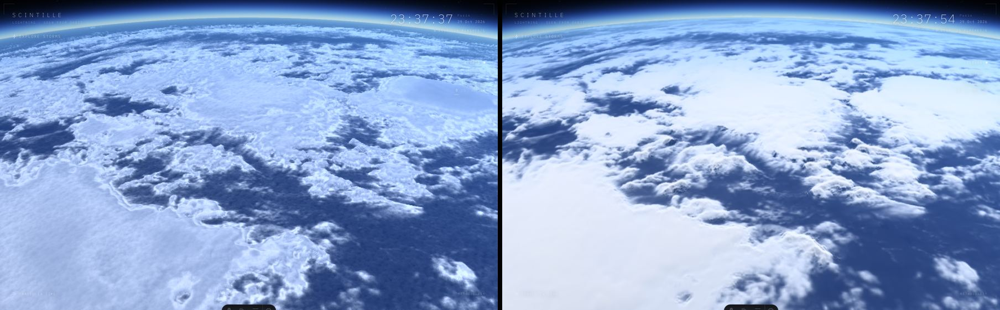

Pacific at noon, `iss` pose: uniform grain and plastic edges, then smooth plateaus and fibrous edges
drawn from the visible channel:
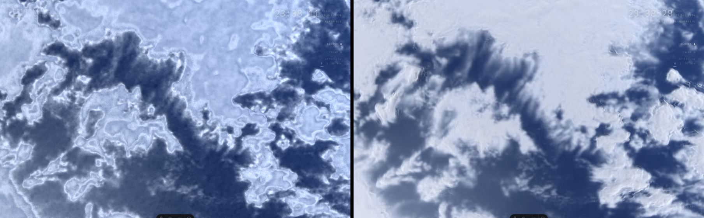

Vaupés storm (Colombia) at dusk, storm follow: dark mush, then peach-lit towers casting long shadows
on lower clouds:
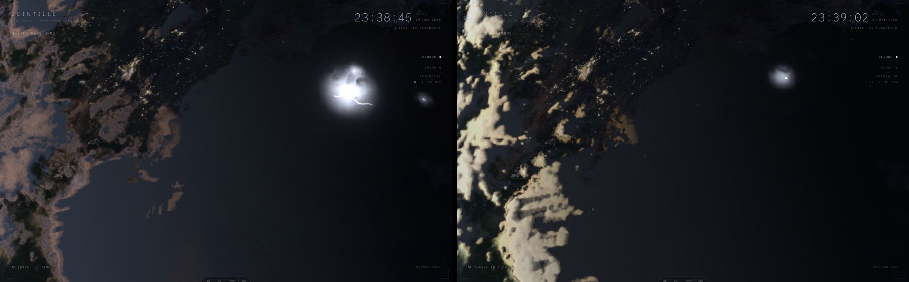

Vaupés, `window` pose:
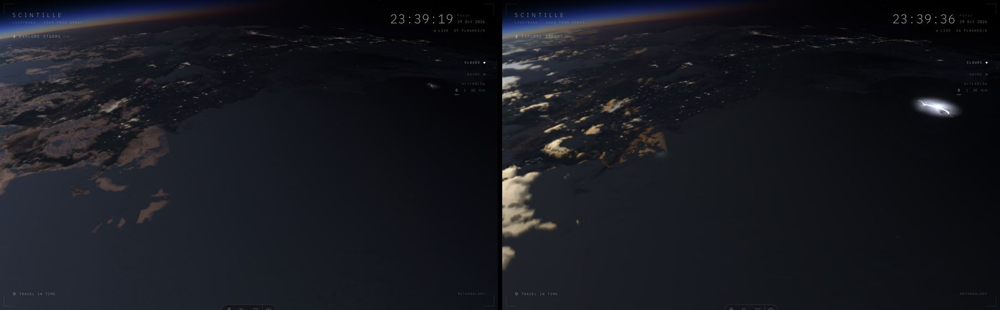

New renderer only. Left, an anvil plateau with flashes visible on and through it, isolated cumulus
and their shadows. Right, Central Africa at night: the flash lights the cloud around it and leaves
no trail on the next frame:
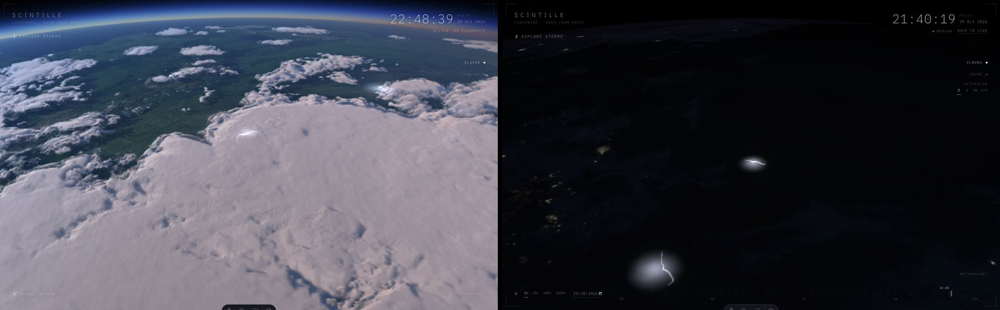

## Against ISS photographs

Two NASA astronaut photographs in conditions close to the captures (public domain, NASA Earth
Observatory and Gateway to Astronaut Photography).

Northeast Brazil at sunset (ISS060-E-71360, "Long, Tall Shadows") against the Vaupés follow view.
Same physics: pink tops, long cast shadows. Our shadows still show 1 km steps:
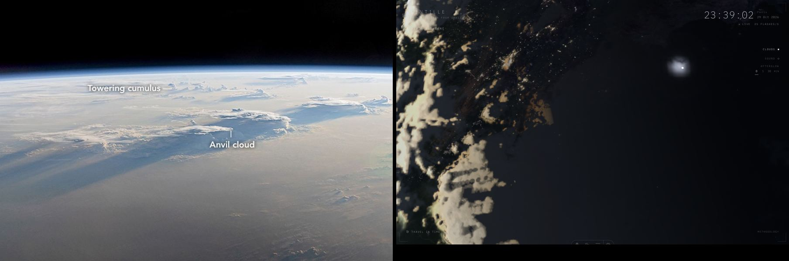

West Africa, 2015-07-16 (anvil, towers and a field of small cumulus) against an anvil `window` view.
The smooth bright plateau and shadowed cumulus match; the dense field of small cumulus is missing,
because the infrared barely sees warm low clouds:
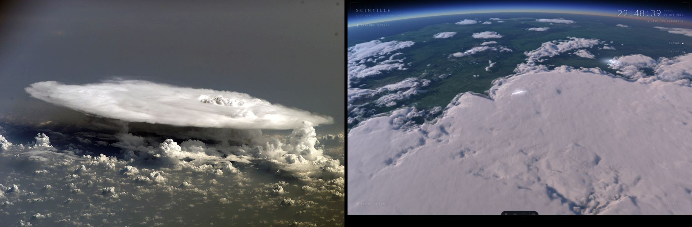

## Against the written brief

The maintainer's brief describes ten genera seen from space and the light of a low and a high sun.

| Brief | Render | Match |
|---|---|---|
| Anvil: a fan, a large irregular palette | Smooth plateaus at observed tops, radiating streaks on the margins | Yes |
| A dome rises above the anvil and casts a small shadow | Domes on tops above their 8 km ring, computed shadows | Yes |
| A low sun reveals every bump with stretched shadows | Stronger relief at a grazing sun, long cast shadows | Yes |
| Ivory, peach or pink, blue-grey hollows | Sun reddened by the air under each height, blue-grey sky ambient | Yes |
| A high sun flattens shadows, surfaces look almost flat | Short shadows; relief on towers, overshooting tops, walls and creases; broad decks in a lowered, stylised light; whites kept below white | Departs on purpose (second review) |
| Cirrus: filaments, wisps, nearly invisible | Thin veil on semi-transparent edges, fibres along iso-lines | Partly |
| Cumulus: islands of relief, shadow beside them | Relief and ground shadow where the infrared sees them | Partly |
| Stratocumulus: closed and open cells | No invented cells: too warm for the infrared | No |
| Repeating, mechanical motif (what to avoid) | No periodic texture anywhere | Avoided |

## Midday

The first version of the PR looked right at dawn and dusk but flat at noon, and softer than the flat
layer. Measured on replays of 2026-10-29 at local noon (sun 64 to 85°), with three independent
analyses (code, captures, research on astronaut photographs at a high sun):

| Cause | Effect | Change |
|---|---|---|
| Sunlit colour above 1 on every cloud pixel, no tone curve | Clipped to plain white: no shading could show | Highlight shoulder from 0.6, hue kept; exposure 0.86 under a high sun |
| Opacity eased to 0.8 | 20 % of the sea through every deck: grey, see-through clouds, observed texture squashed | Clouds eased to 0.95; flashes still veiled as if 0.8 |
| Slope term halved under a high sun, read over 4 km | Under 1 % of shading from relief | Incidence of 3 km slopes on dense tops, 1.5× steeper, faded when looking along the sun; grey sun-facing walls; creases from the sky each top sees |
| 1 km window on the screen centre | Magnified foreground drawn from 2 km texels, blocky holes at dusk | Fine windows centred lower on screen, kept nested |
| Tops stored in 8 bits (78 m steps) | Contour stripes inside towers | Field kept in half floats |
| Billows `0.707 − \|n\|` | Sharp ridges, tops raised 0.9 km on average where they apply | Rounded domes, zero on average, at 4 and 8 km on active tops |

Old (first version of the PR) on the left, now on the right.

Towers at noon, seen from above: the contour stripes are gone, the tops whiter.
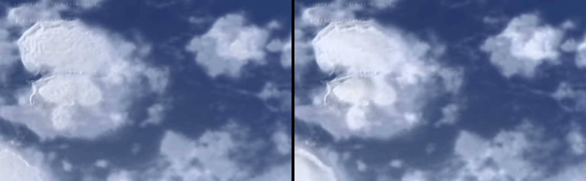

Storm follow at noon: white decks instead of grey, shaded towers.
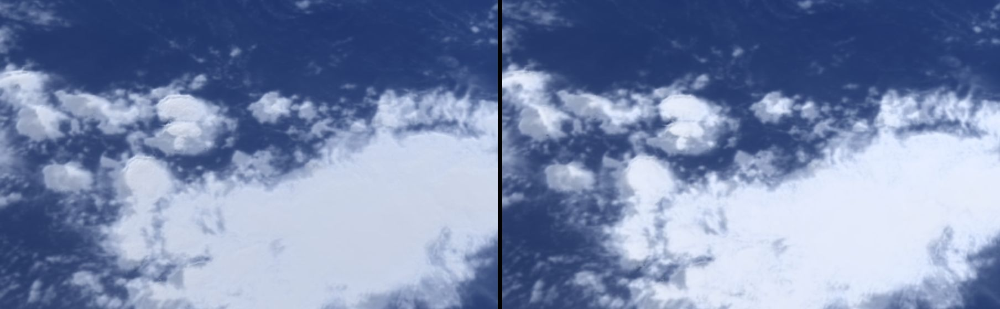

Nadir at noon: as white and smooth as photographs at a high sun.
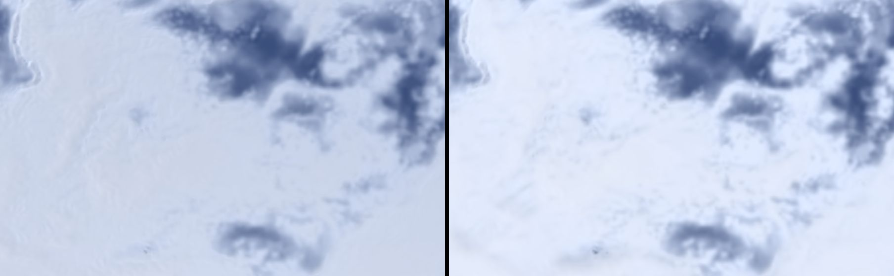

Dusk keeps its warm light and long shadows.
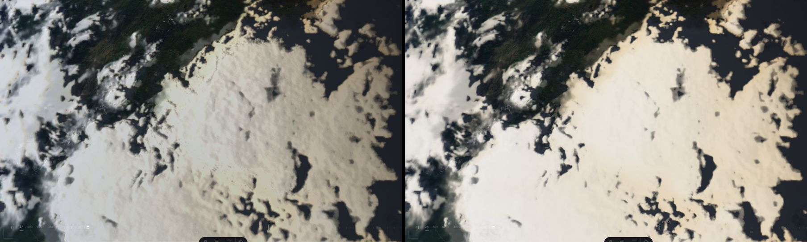

**Tried and rejected.** Drawing slopes 4× steeper under a high sun, a larger swell and lumps on
every sheet gave relief everywhere, but as grey marbling seen from above and a dimpled deck at dusk
(left: rejected, right: kept):
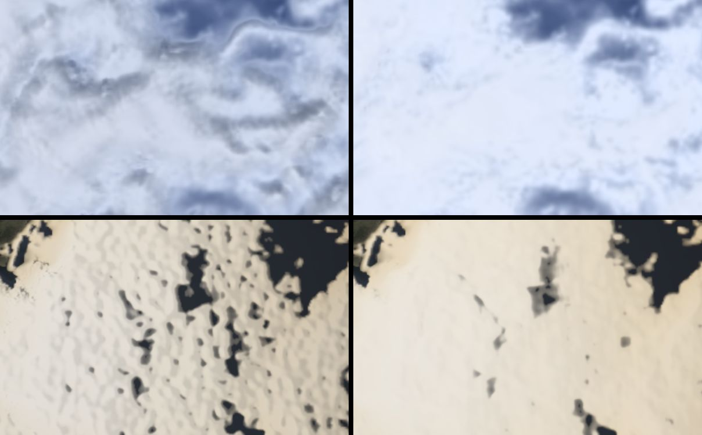

Astronaut photographs at a high sun (ISS029-E-7925, ISS015-E-27689, ISS006-E-23043,
ISS017-E-14836, ISS024-E-5396) show relief as bright rounded lumps on overshooting tops, grey walls
in oblique views and short shadows, while broad anvils stay smooth and nearly white. The first
midday update followed that: noon relief only where the clouds have shape, not painted on every
deck. The second review found it too flat and asked for more, even if stylised (below).

Still softer than the flat layer: the march draws half the screen resolution, so small cumulus and
edges lose some sharpness (about 0.7 of the flat layer's finest detail in oblique views).

### Stylised deck light

Second review: "more relief on the large decks at noon, even if more stylised, without marbling or
orange peel". Under a high sun the decks now take a light of their own, baked with the 4 and 8 km
windows:

- **Shape**: the observed dense tops, spread by Gaussians 6 and 16 km wide. Nothing finer: no
  billow crease, no 2 km texel and no noise reaches it, so no line or regular dimple can appear.
  On a flat observed deck it stays flat; the swell (14 km) is smoothed away.
- **Light**: the 6 km shape drawn 6× steeper (tilt at most 45°), lit by the sun lowered to 40°
  with its own azimuth; hollows below their 16 km surroundings up to 18 % darker, so they read
  from any side, the sun behind the camera included (northern winter at noon, north up). The
  shaded side turns a little bluer, as sky-lit cloud does, rather than grey.
- **Where**: large decks only, dense over most of their 16 km surroundings; isolated towers keep
  the light of their own slopes. On the top, fading within about a kilometre below it; thin edges
  take their deck's light, so no bright line follows the border of a hole. It fades in from 20° to
  49° of sun elevation and is off at night: dusk replays differ from before by 0.2 grey levels on
  average.

First version (left), now (right), same replays as above.

Nadir at noon: the deck's broad shape instead of a white plain.
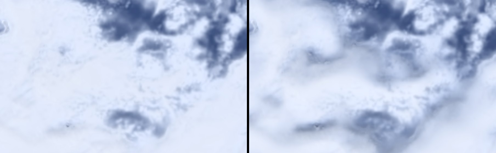

Storm follow at noon: the anvil and the deck beside it in relief.
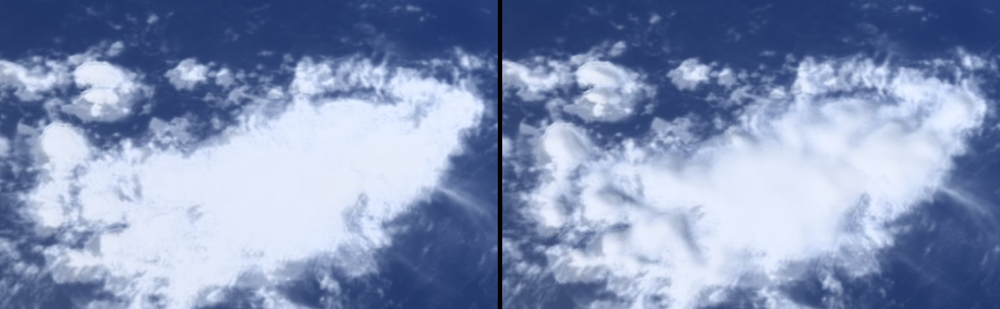

Storm follow over the Pacific deck: rounded swells where the first version was a white plain.
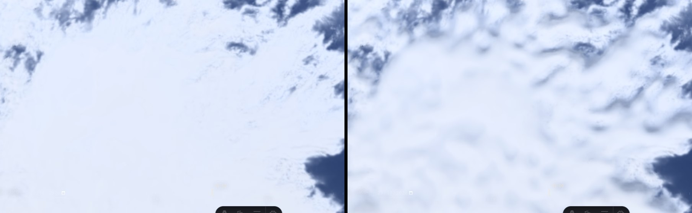

`window` pose at noon: undulations toward the horizon.
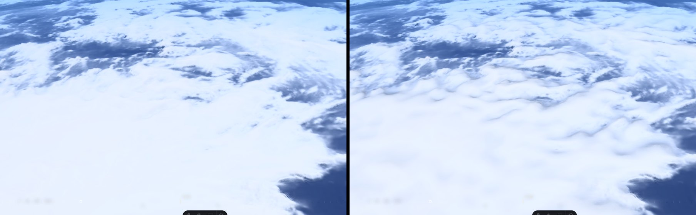

**Tried and rejected** (left: rejected, right: kept). Reading the shape on three rings of 8 points
instead of smoothing it drew polygons and ghost copies of each top; lighting only the densest texels
left a bright line along every hole; the same light on every cloud stained small clouds over land
khaki (live, Gulf of Guinea, 2026-10-30 14 UTC). Filling the shade with bluish light instead of
tinting it halved the relief, which the highlight shoulder already compresses:
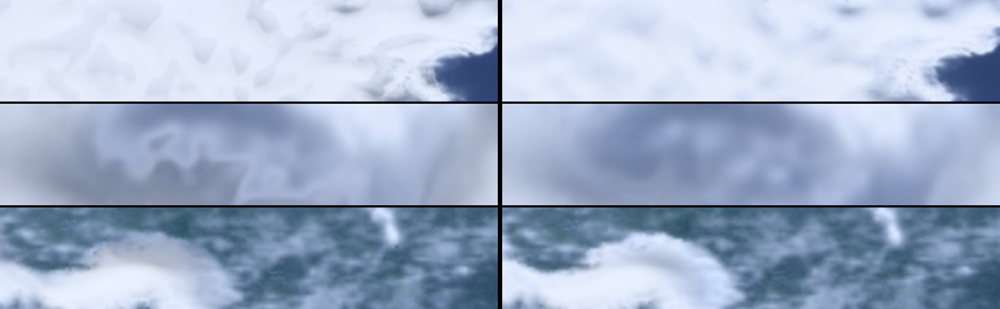

## Bounds and cost

Style bounds (ADR 0030 rule 2) hold at five places, read back from the shader in full precision
with `cloudVolume.styleCheck()`: mean cover difference at most 0.0013 (bound 0.05), worst 4 km block
0.073 (bound 0.1), saturated tops within 0.95 km (bound 1 km). Frame cost on the reference Mac stays
at the first version's level. Tables in [ADR 0031](adr/0031-cloud-look.md#measurements).

No new R2 object or byte: the renderer uses the tiles already published. The deck light is shading
only: cover and tops, and so the bounds, do not move.

## Hover cloud type: evaluation

Not implemented. Hovering a cloud to outline it and show its type, size and area is feasible at no
R2 cost wherever heights exist: live and over the last 24 hours everywhere, and for 30 days under
the ten strongest storms of each day.

- **Pipeline**: a class map baked on the GPU with the style pass, read back once per satellite frame
  or window move (1 MB), connected components in a worker (about 6 ms measured on a 512² window),
  the object under the pointer found by a ray to the top, not the ground. Nothing per frame.
- **Labels**: cumulonimbus only when flashes are observed (WMO rule), "probable" otherwise; anvil,
  overshooting tops (Bedka 2010 test), high cloud of the cirrus family, mid-level cloud, low cloud
  field by day. The JMA satellite classes (Ci, Cm, St, Sc, Cu, Cg, Cb) name genera "for
  convenience"; finer genera (altostratus, cirrocumulus) are never shown alone.
- **Figures**: area (`R² Δλ (sin φN − sin φS)` per texel), equivalent diameter, top range, number
  of overshooting tops, flashes per minute, change over the last hour.
- **Outline**: a thin interface line on hover, like the storm outline, never drawn into the clouds
  (ADR 0030 rule 4). A tap on phones.
- **Effort**: about four days. Start with storm anatomy (cumulonimbus, anvil, overshooting tops),
  reliable and striking; other families later with careful wording. A 30-day catalogue everywhere
  would need an hourly height image (about 0.1 to 0.15 GB over 30 days, estimated).

## Open points

- Frame cost on a mid-range laptop (Iris Xe, `medium`) and on a phone is estimated, not measured.
- The lift of semi-transparent anvil edges is assumed; validate against GOES `ACHA2KMF`.
- Warm low clouds stay faint; no stratocumulus cells.
- Shadows at a very low sun keep 1 km steps.
- Old replays without heights show the flat layer close up.
